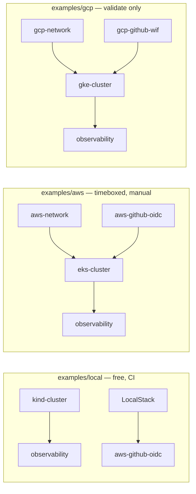

# platform-modules

Reusable Terraform modules for AWS and GCP platforms, plus three examples that compose them: a free local stack (kind + LocalStack), a timeboxed AWS stack, and a plan-only GCP stack.

Every module takes cloud, region, account and naming values as inputs. There are no account IDs, regions, ARNs or backends inside `modules/`; the caller owns providers and state.

## Modules

| Module | Cloud | What it creates | Key inputs | Outputs |
| --- | --- | --- | --- | --- |
| [`aws-network`](modules/aws-network) | AWS | VPC, public and private `/24` subnets, NAT gateway(s), route tables, optional flow logs | `name_prefix`, `vpc_cidr`, `az_count`, `single_nat_gateway` | `vpc_id`, `public_subnet_ids`, `private_subnet_ids`, `nat_gateway_ids`, `flow_log_group_name` |
| [`gcp-network`](modules/gcp-network) | GCP | VPC, one subnet per region, flow logs, default deny ingress | `name_prefix`, `project_id`, `subnet_cidrs` | `network_id`, `subnet_ids`, `subnet_names` |
| [`kind-cluster`](modules/kind-cluster) | Local | kind cluster via `terraform_data` | `name_prefix`, `node_count` | `cluster_name`, `context` |
| [`eks-cluster`](modules/eks-cluster) | AWS | EKS 1.33 cluster, managed node group, IRSA OIDC provider, control-plane audit logs | `name_prefix`, `cluster_version`, `subnet_ids`, `public_access_cidrs` | `cluster_name`, `cluster_endpoint`, `cluster_ca_certificate`, `oidc_issuer_url`, `node_group_name` |
| [`gke-cluster`](modules/gke-cluster) | GCP | Regional GKE cluster, node pool, workload identity | `name_prefix`, `project_id`, `region`, `network_id` | `cluster_name`, `cluster_endpoint`, `ca_certificate`, `workload_identity_pool` |
| [`aws-github-oidc`](modules/aws-github-oidc) | AWS | GitHub OIDC provider, ref-scoped role, inline `sts:GetCallerIdentity` | `name_prefix`, `github_org`, `github_repo`, `allowed_refs` | `role_arn`, `role_name`, `oidc_provider_arn`, `trust_policy_json` |
| [`gcp-github-wif`](modules/gcp-github-wif) | GCP | Workload identity pool, OIDC provider, deployer service account | `name_prefix`, `project_id`, `github_org`, `github_repo`, `allowed_refs` | `service_account_email`, `workload_identity_provider` |
| [`observability`](modules/observability) | Kubernetes | kube-prometheus-stack with SLO recording and burn-rate rules | `namespace`, `slos`, `prometheus_retention` | `namespace`, `grafana_service`, `prometheus_service`, `slo_rules_yaml` |

## Composition



## Quickstart (local, no cloud account)

Requires Docker, `kind`, `kubectl`, and Terraform ≥ 1.9.

```bash
make up
bash scripts/test-local.sh platform-local
make down
```

`make up` creates a kind cluster, a LocalStack container, the placeholder workload, kube-prometheus-stack, and a GitHub OIDC role. `make down` removes all of it.

## Test matrix

| Concern | Local (free) | Mock (`terraform test`) | Real cloud (manual) |
| --- | --- | --- | --- |
| network (AWS) | plan only | yes | apply + destroy |
| network (GCP) | plan only | yes | documented, not run |
| cluster kind | apply | — | — |
| cluster EKS | — | yes | apply + destroy (60-minute window) |
| cluster GKE | — | yes | documented, not run |
| identity + OIDC (AWS) | LocalStack apply | yes | bootstrap once, reused |
| identity + WIF (GCP) | — | yes | documented, not run |
| observability | apply on kind | yes | apply on EKS |

`make test` runs every module's suite with mocked providers and no credentials. `make lint` runs `terraform fmt -check` and `tflint`.

## Real AWS run

`docs/runbooks/aws-demo.md` is the 60-minute runbook: pre-flight, a 25-minute apply ceiling, demo checks, destroy, and `scripts/verify-no-aws-resources.sh` to prove nothing was left behind. The recorded run lives in `docs/runs/` once it has happened.

## Limitations, stated openly

- LocalStack community stands in for IAM and STS only. VPC and EKS are Pro features; the AWS network and cluster are mock-tested, not applied locally. See [ADR 0002](docs/adr/0002-localstack-test-boundary.md).
- GCP is mock-tested and has never been applied; no project was available. See [ADR 0003](docs/adr/0003-gcp-not-applied.md) and `examples/gcp/README.md`.
- The AWS demo is timeboxed and destroyed in the same window; it is not a running service.
- CI runs with no cloud credentials. Anything that needs a real account is a manual step with a linked record.

## Repository layout

```text
modules/        one directory per module, each with tests/
examples/local/ kind + LocalStack (make up / make down)
examples/aws/   VPC → EKS → OIDC → observability
examples/gcp/   VPC → GKE → WIF → observability (validate only)
docs/adr/       decisions, including the testing boundaries
docs/runbooks/  the manual AWS run
scripts/        local smoke test and AWS resource verification
```

## Conventions

- `name_prefix` matches `^[a-z][a-z0-9-]{1,20}$`.
- Inputs are validated at the boundary; a wrong CIDR or an unsafe default fails at plan time.
- Trust policies are scoped to `repo:org/repo:ref:...`; a bare `*` is rejected.
- Public endpoints need an explicit allowlist; the EKS module requires `/32` entries.
- Modules never set a provider or a backend.
- New behaviour arrives with a test that failed first.

## Decisions

- [ADR 0001: three focused repositories](docs/adr/0001-three-repos.md)
- [ADR 0002: LocalStack boundary](docs/adr/0002-localstack-test-boundary.md)
- [ADR 0003: GCP is mock-tested, never applied](docs/adr/0003-gcp-not-applied.md)

## License

Apache-2.0. See [LICENSE](LICENSE).
